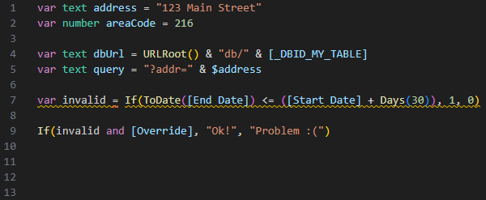

# Quickbase Formula & Query Tools

VS Code language support for Quickbase formulas and query expressions. This extension adds syntax highlighting, snippets, hover documentation, and live validation for `.quickbase` files so formula work is easier to read, write, and review.



## Requirements

VS Code 1.18 or later.

Use the `.quickbase` file extension for Quickbase formulas, formula-query expressions, and standalone query text.

## Features

- Syntax highlighting for Quickbase formulas, comments, operators, variables, variable declarations, bracketed field and table references, and modern Quickbase functions
- Query-aware highlighting for API query strings and formula-query expressions, including operators like `EX`, `GT`, `TV`, `WC`, logical joiners like `AND` and `OR`, and special values such as `'today'` and `'_curuser_'`
- Snippets for Quickbase functions, variables, and common authoring patterns
- Live diagnostics for structural formula errors, malformed query expressions, duplicate variables, invalid variable names, unknown variable types, unknown functions, regex-pattern issues, and baseline argument/type mismatches
- Hover documentation for formula-query functions, query operators, variable declarations, variable types, bracketed references, and special query values
- Optional field type hints in comments for diagnostics and hover documentation
- Function coverage through the October 2026 documentation audit, including `Distance()`, `Find()`, `RemoveNewlineCharacters()`, `StDev()`, and `URLDecode()`
- Regression tests for the language services and extension, plus PowerShell/Pester grammar checks and committed snapshots

## Examples

```quickbase
var RecordList openProjects = GetRecords("{'6'.EX.'In Progress'}", [_DBID_PROJECTS]);
var TextList owners = GetFieldValues($openProjects, 8);

Join($owners, "; ")
```

```quickbase
var Text todayQuery = "{'13'.EX.'today'}AND{'20'.TV.'_curuser_'}";
```

Queries can include grouped conditions and numeric values without quotes:

```quickbase
GetRecords("({6.EX.'Open'}OR{6.EX.'Pending'})AND{72.LT.150}")
```

Enclose decimal query values in quotes, as in `{12.EX.'5.6'}`. Quickbase truncates an unquoted decimal value. The extension reports warning `QB114` for this case.

`Distance()` accepts four coordinates and an optional unit (`"miles"` or `"km"`):

```quickbase
Distance([Customer Latitude], [Customer Longitude], [Warehouse Latitude], [Warehouse Longitude], "km")
```

## Field type hints

Use a structured comment to specify a field type:

```quickbase
// @qb-type [Price]: Number
// @qb-type [Quantity]: Number

var Number total = [Price] * [Quantity];
$total
```

Quickbase treats `//` through the end of the line as a comment. These hints can stay in a formula that you paste into Quickbase. See [Quickbase comment syntax](https://help.quickbase.com/v1/docs/best-practices-writing-formulas).

The extension uses hints for assignment checks, function argument checks, arithmetic, and field hovers. A hint describes the existing field type. It does not convert values or change how Quickbase evaluates the formula.

- Hints apply throughout one file. The field name must match the reference, including spelling and case.
- Supported types: `Bool` (or `Boolean`), `Number` (or `Numeric`), `Text`, `TextList`, `Date`, `DateTime` (or `Date/Time`), `Duration`, `TimeOfDay`, `WorkDate`, `User`, and `UserList`.
- Invalid hints produce warning `QB112`. Conflicting hints produce warning `QB113` and leave that field untyped.
- Fields without hints retain conservative type inference. Formula variables use their native `var Type name` declarations.

## Current Scope

The extension does not execute formulas or connect to Quickbase metadata. Field hints are local assertions. The extension cannot compare them with the actual field types in your application.

## Development

Reference notes gathered from current Quickbase documentation live in `docs/quickbase-documentation-notes.md`.

Use Node.js 22 or later for development. The tests require no npm dependencies.

Run the language-service, hover, fixture, and extension regression tests:

```sh
npm test
```

With an installed copy of VS Code, the suite also checks actual TextMate and Oniguruma tokens. For a custom installation, set `QUICKBASE_VSCODE_APP` to its `resources/app` directory. The suite skips that check without an installed copy.

On Windows, also run the grammar checks and existing fixture tests with PowerShell and Pester 3:

```powershell
powershell -NoProfile -ExecutionPolicy Bypass -Command "Invoke-Pester .\tests -EnableExit"
```

The fixture runners use Node.js. They do not require Windows Script Host. The grammar snapshots contain regex-derived tokens. The Node suite also checks the actual TextMate engine.

Refresh committed tokenization snapshots after an intentional grammar change:

```powershell
powershell -ExecutionPolicy Bypass -File .\tests\Invoke-QuickbaseTokenization.ps1 update
```

## Attribution

This project builds on the original `vscode-quickbase-formula` extension and its contributors.

- Justin Klubnik created the original extension, published the initial Quickbase syntax support, and remains the named copyright holder in `LICENSE.txt`
- Chris Pliakas contributed later grammar, snippet, scope, and branding updates that expanded the extension's Quickbase coverage
- Derek Banker led the current modernization work, including updated formula and query support, diagnostics, hover documentation, and automated regression testing

## License

MIT-style license. See `LICENSE.txt`.
